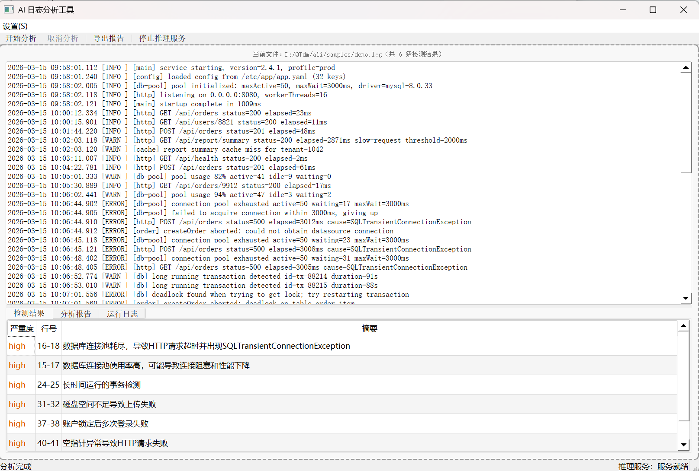
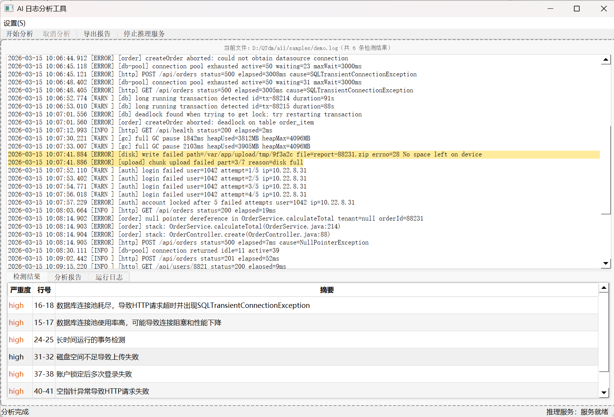
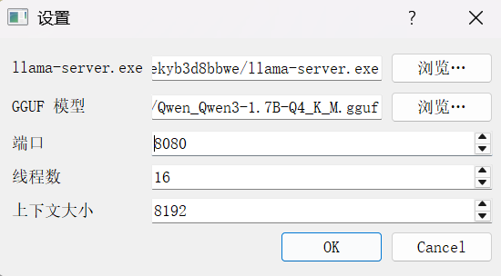

# aii — 本地 AI 日志分析工具


拖入一个日志文件，程序解析后调用**本地大模型**（llama.cpp 的 llama-server）做异常检测与总体摘要。全程离线，数据不出本机。这是一个 1-2 个月实习项目，核心是打通「Qt 桌面 UI → 长日志分块 → 本地 LLM 逐块检测 → 结构化结果跳转回日志」的完整闭环。

> 开发状态：功能已完成，端到端可跑（`server_test` 控制台闭环 + GUI 手动验证）。设计细节见 [docs/DESIGN.md](docs/DESIGN.md)。

## 效果示例

仓库自带一段含典型故障的示例日志 [`samples/demo.log`](samples/demo.log)（56 行，模拟一个订单服务的运行记录）。拖进程序跑一次，得到：



**输入节选**

```
15  2026-03-15 10:06:02.441 [WARN ] [db-pool] pool usage 94% active=47 idle=3 waiting=2
16  2026-03-15 10:06:44.902 [ERROR] [db-pool] connection pool exhausted active=50 waiting=17 maxWait=3000ms
24  2026-03-15 10:06:52.774 [WARN ] [db] long running transaction detected id=tx-88214 duration=91s
31  2026-03-15 10:07:41.884 [ERROR] [disk] write failed path=/var/app/upload/tmp/9f3a2c errno=28 No space left on device
37  2026-03-15 10:07:57.229 [ERROR] [auth] account locked after 5 failed attempts user=1042 ip=10.22.8.31
39  2026-03-15 10:08:14.902 [ERROR] [order] null pointer dereference in OrderService.calculateTotal tenant=null orderId=88231
```

**输出（检测结果列表，Qwen3-1.7B Q4_K_M 本地实测）**

| 起止行 | 严重度 | 摘要（模型原话） |
|---|---|---|
| 16-18 | 🔴 high | 数据库连接池耗尽，导致 HTTP 请求超时并出现 SQLTransientConnectionException |
| 15-17 | 🔴 high | 数据库连接池使用率高，可能导致连接阻塞和性能下降 |
| 24-25 | 🔴 high | 长时间运行的事务检测 |
| 31-32 | 🔴 high | 磁盘空间不足导致上传失败 |
| 37-38 | 🔴 high | 账户锁定后多次登录失败 |
| 40-41 | 🔴 high | 空指针异常导致 HTTP 请求失败 |

双击任意一行 → 日志视图跳转到对应行，并高亮整个起止行范围：



> 上表是一次真实运行的完整输出，未做人工修饰。1.7B 小模型的短板在这里很直观：6 条全部判成 high（严重度分级偏粗）、措辞笼统、漏掉了 26-27 行的死锁与 29-30 行的 Full GC，15-17 与 16-18 还有重叠。换 7-8B 模型后分级与描述会明显更细。**不变的是：行号能对上原文，双击即可核对。**

## 功能特性

- **拖放即用**：拖入 `.log` / `.txt` 自动解码显示（BOM → UTF-8 → GB18030 → GBK 逐级探测，中文日志不乱码）
- **本地 LLM 异常检测**：长日志按 token 预算分块（相邻块重叠 8 行），逐块调 llama-server 检测异常，再 map-reduce 汇总成总体报告
- **行号可追溯**：检测结果以列表呈现（严重度着色），**双击任意一条 → 日志视图跳到对应行并高亮整个起止行范围**
- **流式输出**：「模型输出」页实时滚动模型这次说的话（含分块分隔线），分析过程不是黑盒；UI 侧 50ms 合并刷新，不会因为一秒几百次 append 拖慢界面
- **规则兜底**：即使 LLM 全部失败，也会输出纯规则的 ERROR/WARN 统计 + 错误关键词报告
- **报告导出**：Markdown 报告可导出为 `.md`（原文）或 `.html`（内置转换渲染）
- **按需启动服务**：llama-server 只在点"启动推理服务"或"开始分析"时才拉起；分析全程 UI 不卡顿（QThread）
- **端口预检与复用**：启动前探测端口——已有健康的 llama-server 直接复用（省一次模型加载）；被其他程序占用则弹窗提示改端口
- **设置页**：模型路径、端口、线程数等经 QSettings 持久化

## 技术栈

| 层 | 技术 |
|---|---|
| UI / 框架 | Qt 5.14.2（Widgets + Network），QMainWindow |
| 语言 / 构建 | C++14（原模板 C++11 已升级），CMake ≥3.5，MinGW 7.3.0（GCC 7.3） |
| 推理后端 | [llama.cpp](https://github.com/ggml-org/llama.cpp) 预编译 `llama-server.exe`（子进程 + OpenAI 兼容 HTTP API，SSE 流式） |
| 模型 | GGUF 格式；开发调试用 Qwen3-1.7B Q4_K_M，实际使用建议 7-8B Q4_K_M（CPU 推理） |

## 技术决策

| 决策点 | 选择 | 理由 |
|---|---|---|
| 推理接入 | 子进程 + OpenAI 兼容 HTTP（Route B） | MinGW 7.3.0（GCC 7.3）编译不了要求 C++17+/GCC 13.3+ 的现代 llama.cpp；子进程还能把「模型崩溃」与「主程序」隔离，升级 exe 不用改代码 |
| 长日志切分 | 按 token 预算分块，相邻块重叠 8 行 | 上下文窗口有限；重叠是为了让恰好跨越块边界的异常不被切断而漏报 |
| 多块汇总 | map-reduce 两级（逐块检测 → 汇总报告） | 全部块塞不进一次请求；两级汇总既保住逐块细节，又产出全局视角 |
| 并发模型 | worker-object + `moveToThread`（不继承 QThread） | 线程与业务对象解耦；代价是对象不能有 parent、`run()` 里不跑槽函数 |
| 服务生命周期 | 端口预检 + `/health` 轮询 500ms | 复用已在跑的实例省一次模型加载；避免端口冲突时静默失败 |
| 模型输出容错 | 三段：掐头去尾 → 兼容 `[...]` / `{"findings":[...]}` 两种形态 → 逐条字段归一，失败返回 Retry 触发重试 | 小模型不保证输出合法 JSON，管线不能因此整条中断 |
| 关闭模型思考 | 请求体带 `chat_template_kwargs: {enable_thinking: false}` | Qwen3 类模型默认先把整段 `reasoning_content` 说完再写正文，输出预算会被思维链吃光、JSON 只写一半就被截断（本项目踩过：512 token 全被思维链占用，正文只剩 121 字符）。该字段由 chat template 解释，模板里没有它的模型会直接忽略 |
| 结果可追溯 | finding 带起止行号，双击跳转并高亮整段 | 「检测到异常」不够，运维要能一秒看到原始上下文 |

> 更完整的取舍与放弃的替代方案见 [docs/DESIGN.md](docs/DESIGN.md) 第 7 节。

## 提示词与输出契约

小模型不会"猜"你的意图，格式必须写死。检测阶段的契约分三层。

**1. 系统提示词**（[`promptbuilder.cpp:58`](promptbuilder.cpp)）——一句角色 + 六条硬约束：

| 约束 | 要解决的问题 |
|---|---|
| 只输出一个 JSON 数组，不要解释 / 前言 / 代码块 | 小模型最爱在 JSON 前面写"好的，分析结果如下" |
| 固定五字段：`severity` `start_line` `end_line` `summary` `details` | 下游解析只认这五个 |
| 行号必须引用日志里真实出现的行号 | 双击跳转全靠它，错了就跳到无关的行 |
| 无异常时输出 `[]` | 让"没有异常"成为**合法结果**，而不是解析失败 |
| 不编造、宁缺毋滥 | 1.7B 很容易把正常日志硬说成异常 |
| 相邻同因异常合并成一条起止范围 | 否则一段连环报错会吐回 20 条重复结果 |

输入侧每行带 `行号|内容` 前缀（[`logchunker.cpp:11`](logchunker.cpp)），模型才有"行号"这个概念可用。

**2. 请求参数**（[`llamahttpclient.cpp`](llamahttpclient.cpp)）

| 参数 | 值 | 原因 |
|---|---|---|
| `temperature` | 0.2 | 要可复现的判断，不要创造性 |
| `max_tokens` | 1536（检测）/ 2048（汇总） | 50 行日志通常 5~8 条结果，实测 6 条约需 820 token；512 会在数组中途截断 |
| `response_format` | `{"type":"json_object"}` | 只在检测阶段开；汇总要 Markdown 自由文本，开了反而被语法约束住 |
| `chat_template_kwargs` | `{"enable_thinking": false}` | 关掉思维链，见「踩坑记录」第 1 条 |

`enable_thinking` 是 chat template 解释的模板变量——模板里没有这个变量的模型会直接忽略，所以对非 Qwen3 模型是安全的。

**3. 解析、重试与兜底**（[`resultparser.cpp`](resultparser.cpp)、[`analysisworker.cpp`](analysisworker.cpp)）

解析器做三段容错：

1. **掐头去尾**：从第一个 `{` 或 `[` 截到最后一个 `}` 或 `]`，吃掉模型的前言和后语
2. **两种形态**：`[ {...} ]` 与 `{"findings": [...]}`（`results` / `anomalies` / `issues` / `items` 也认）；连包装都没有、只有一个对象时，当成一条结果
3. **逐条归一**：去尾逗号、`severity` 非法值按 `medium`、行号容忍字符串、起止颠倒自动交换、缺 `summary` 的条目当噪声丢弃

解析失败不等于直接放弃。每块最多 3 次尝试，第 2、3 次换成**重试提示词**：同一段日志 + 上一次的坏输出（截断到 1500 字符）+ 明确要求不要沿用它的格式错误。3 次都失败才落一条 `low` 兜底条目交人工检查——管线不中断，结果列表里也看得见是哪一块没查成。

## 分块算法

上下文 8192，日志动辄几十万行，必须切。切法在 [`logchunker.cpp`](logchunker.cpp)。

**预算**

```
budgetTokens = (ctxSize - 2048) * 0.8        // 8192 → 4915 token
```

- 减去 `kReservedTokens = 2048`：留给系统提示词、用户提示词模板和输出（检测阶段 `max_tokens = 1536`）
- 再乘 0.8：安全余量。token 估算是近似的，宁可早切
- `budgetTokens < 512` 时直接不分块——上下文配得太小，切出来的块没有分析价值

**token 估算**

```cpp
return text.size() / 2 + 1;   // 1 token ≈ 2 字符
```

故意保守：中文实际约 1.5 字符/token、英文约 4 字符/token，取 2 对两者都留余量。估算偏大会多切几块（多几次请求），偏小会超上下文（请求直接失败）——代价不对称，所以选保守。

**切分规则**

- 只在**行边界**切，不在行内硬切；单行的 token 就超预算时，该行独占一块
- 贪心装行，累加到下一行会超预算为止
- 下一块起点回退 **8 行**形成重叠，`qMax(start + 1, end - 8)` 兜底保证始终前进，不会死循环

**为什么要重叠**

异常常常横跨块边界（连接池耗尽在第 N 行、它引发的超时在第 N+1 行）。不重叠的话两块各看到一半，谁都判不出根因。代价是重叠区可能被重复报告——见「已知限制」。

**块数上限**

超过 100 块时不截断尾部，而是**均匀采样** 100 块，覆盖整个时间跨度；报告里会如实写明"已采样"。

## 架构总览

```
用户拖入 .log/.txt
      │
      ▼
┌──────────────────────────────────────────────────────────┐
│  MainWindow（UI 线程）                                     │
│  日志视图（≤2MB 显示）│ 检测结果列表（双击跳行高亮）          │
│  分析报告页 │ 运行日志页 │ 设置页 │ 导出                    │
└──────┬──────────────────────────────┬───────────────────┘
       │ queued 信号                   │ 直连 start()/stop()
       ▼                              ▼
┌─────────────────────┐   ┌──────────────────────────────┐
│ AnalysisWorker      │   │ LlamaServerManager（UI 线程） │
│ （Worker 线程）      │   │ QProcess 生命周期 + 状态机     │
│  LogParser 解析      │   │ /health 就绪轮询（500ms）      │
│  LogChunker 分块     │   └──────────────┬───────────────┘
│  PromptBuilder 提示词│                  │ QProcess 拉起
│  LlamaHttpClient HTTP│◄───HTTP POST /v1/chat/completions（SSE）
│  ResultParser 解析   │──► llama-server 子进程（CPU 推理）
└─────────────────────┘
```

## 目录结构

```
aii/
├── CMakeLists.txt            # 主程序 aii + 控制台闭环 server_test + 单元测试 unit_tests（CTest）
├── README.md
├── LICENSE                   # MIT
├── samples/
│   └── demo.log              # 示例日志（模拟订单服务，含典型故障，可直接试跑）
├── docs/
│   ├── DESIGN.md             # 设计文档：类职责/数据流/线程模型/进程生命周期
│   └── screenshots/          # README 用的界面截图
├── tests/
│   └── unit_tests.cpp        # 单元测试：LogParser / LogChunker / ResultParser（75 项断言）
├── main.cpp                  # qRegisterMetaType + QSettings 归属
├── mainwindow.{h,cpp,ui}     # UI：拖放、结果列表、报告页、设置、导出、服务门控
├── analysisworker.{h,cpp}    # 管线编排（Worker 线程）：解析→分块→逐块检测→汇总
├── llamaservermanager.{h,cpp}# llama-server 子进程生命周期管理
├── llamahttpclient.{h,cpp}   # OpenAI 兼容 HTTP 客户端（SSE 流式）
├── logparser.{h,cpp}         # 编码探测 + 行切分 + 时间戳/级别 + 规则统计
├── logchunker.{h,cpp}        # 按 token 预算分块（行边界 + 重叠）
├── promptbuilder.{h,cpp}     # 系统/块检测/重试/汇总提示词 + 规则兜底报告
├── resultparser.{h,cpp}      # 模型 JSON 输出清洗与解析
├── settingsdialog.{h,cpp}    # 设置页（QSettings 持久化）
├── datatypes.h               # LogEntry / LogChunk / AnomalyFinding
└── server_test.cpp           # W1 控制台闭环测试（仅依赖 QtCore+QtNetwork）
```

## 项目规模

| 指标 | 数值 |
|---|---|
| C++ 源文件 | 21 个（11 个 `.cpp` + 10 个 `.h`）+ 1 个 `.ui` |
| 代码行数 | 约 2,600 行（非空约 2,200 行） |
| 功能模块 | 9 个：UI / 管线编排 / 服务管理 / HTTP 客户端 / 日志解析 / 分块 / 提示词构建 / 结果解析 / 设置 |
| 第三方依赖 | 无，只依赖 Qt 5.14（Widgets + Network）与标准库 |
| 验证方式 | `unit_tests` 75 项断言（CTest 一键跑）+ `server_test` 控制台闭环（不依赖 GUI）+ [`samples/demo.log`](samples/demo.log) 手动回归 |

## 构建与运行

**环境要求**

- Windows + Qt 5.14.2（MinGW 7.3.0 套件），CMake ≥3.5
- `llama-server.exe`（可 `winget install ggml.llamacpp` 获取）
- 一个 GGUF 模型，如 Qwen3-1.7B-Instruct Q4_K_M（下载后放到如 `D:/models/`）

**命令行构建**

```bash
cmake -S . -B build -G "MinGW Makefiles" -DCMAKE_PREFIX_PATH=D:/Qt/5.14.2/mingw73_64
cmake --build build
```

**Qt Creator 构建**

打开 `CMakeLists.txt` → 选择 Desktop Qt 5.14.2 MinGW 7.3.0 64-bit 套件 → 构建运行 `aii`。

**首次运行**

1. 启动 `aii`，菜单 **设置 → 设置…**，填入 `llama-server.exe` 路径与 GGUF 模型路径（其余用默认值即可）
2. 拖入一个日志文件，点 **开始分析**——程序会自动拉起 llama-server，模型加载就绪后自动开始分析（CPU 推理，加载与逐块检测需要耐心）

设置页（模型路径 / 端口 / 线程数 / 上下文大小，经 QSettings 持久化）：



## 验证方式

三道验证，成本从低到高。

**1. 单元测试（不需要模型）**

```bash
cmake --build build --target unit_tests
ctest --test-dir build --output-on-failure
```

75 项断言，覆盖三个纯函数模块：

| 模块 | 覆盖点 |
|---|---|
| `LogParser` | UTF-8 BOM / UTF-8 / GB18030 / UTF-16LE 四种编码、级别提取与取最高者、空行跳过后行号不塌陷、规则统计 |
| `LogChunker` | token 估算、预算下限、重叠 8 行、块必须前进、超长单行独占一块、上下文过小返回空 |
| `ResultParser` | 代码围栏、尾逗号、包装对象、单对象、severity 归一、行号容错、非 JSON 返回 Retry |

为什么只测这三个：它们是纯输入输出，不碰网络、不碰 UI、不碰模型。把这三块钉死，剩下的不确定性就只剩模型本身。

**2. 控制台闭环（需要模型，不需要 GUI）**

```bash
./server_test.exe
```

拉起 llama-server → 轮询 `/health` 就绪 → 发一次 chat → 校验收到流式增量。验证的是"子进程管理 + HTTP + SSE 解析"这条链路，与界面无关。

**3. 手动回归**

`samples/demo.log` 拖进程序跑一次，对照上文「效果示例」核对行号与摘要。

## 踩坑记录

按「症状 → 定位 → 修法 → 结论」记，都是这个项目里真踩过的。

### 1. 检测结果只有一条 `low`，提示"LLM 输出不可解析"

- **症状**：56 行日志跑完，检测结果列表只有 `low | 1-56 | 该块 LLM 输出不可解析（已重试 3 次）`，报告是规则兜底产物。
- **定位**：复刻程序发出的请求，看到 `finish_reason = length`、`completion_tokens = 512`——预算全花光，正文却只有 121 字符，JSON 断在 `"details": "` 处。多出来的部分是 `reasoning_content`：Qwen3 默认先把整段思维链说完再写正文，512 的预算根本轮不到正文。
- **修法**：请求体加 `chat_template_kwargs: {"enable_thinking": false}`，`max_tokens` 提到 1536。同一段日志重跑：54.7 秒、`finish_reason = stop`、816 token、合法 JSON 6 条。
- **结论**：**"模型没能力"和"预算没给够"看起来一模一样**。判断依据不能靠感觉，要看响应里的 `finish_reason` 和 `completion_tokens`。

### 2. 空闲端口被判成"被占用"

- **症状**：本地没有程序占用 8080，点开始分析却弹"端口已被占用"。
- **定位**：端口预检用 2 秒超时来判断"连不上 = 端口空闲"。实测 Windows 上 `ConnectionRefusedError` 要约 4 秒才送达——2 秒内没有任何信号，超时被当成"连上了"，反被判成占用。
- **修法**：改用同步 `waitForConnected(500)`，用"连接成功 / 明确失败"这个确定结果替代"等了多久"这个时间猜测。
- **结论**：**用时间做判断条件是脆弱的**，对端慢一点就翻车；能用确定状态就别用时间猜。

### 3. 高亮范围的最后一行只有文字宽度

- **症状**：双击检测结果跳转后，起止行的中间行满行黄色，最后一行只黄到文字末尾。
- **定位**：`movePosition(EndOfBlock)` 停在末行的"行尾字符"，没把换行符纳入选区；而 `QTextFormat::FullWidthSelection` 只在选区含换行符时才画满整行宽。
- **修法**：`EndOfBlock` 之后再 `movePosition(NextCharacter, KeepAnchor)` 吞掉末行换行符。
- **结论**：Qt 里"选到行尾"和"选到换行"是两件事，画满整行要的是后者。

### 4. 报告里的「共 N 行」比实际多 1

- **症状**：写单元测试时发现，56 行的文件 `totalLines` 是 57。
- **定位**：`text.split('\n')` 对以换行结尾的文件会多切出一个空段，那不是一行。
- **修法**：切分后若最后一段为空则丢弃（连续两个换行结尾时，倒数第二个空段才是真正的空行）。
- **结论**：**这个 bug 是单元测试逼出来的**——手动跑一百遍也不会注意到 56 和 57 的差别。

## 已知限制

- **平台/工具链**：仅在 Windows + MinGW 7.3.0 验证；受工具链限制无法直接编译现代 llama.cpp，依赖预编译 `llama-server.exe`
- **日志格式**：仅支持行式文本 `.log`/`.txt`；时间戳/级别靠有限正则识别，特殊格式可能解析为 unknown；>200MB 文件拒绝分析
- **显示上限**：日志视图只显示前 2MB（分析本身使用完整文件），超出部分的 finding 无法跳转显示
- **性能**：CPU 推理（`-ngl 0`），大模型单块检测可能耗时数十秒；超大日志按 100 块均匀采样（报告会如实标注）
- **检测质量**：取决于本地模型能力；LLM 失败时自动降级为规则统计报告（有产出但无模型级分析）
- **端口冲突**：默认 8080 被占用（包括残留的孤儿 llama-server 进程）时服务启动失败，需 `tasklist | findstr llama` 后手动结束
- **设置生效时机**：服务运行中修改端口/线程数/上下文大小，需重启推理服务后生效
- **HTML 导出**：使用 Qt 内置 Markdown 转换，样式为基础渲染

## 延伸阅读

- [docs/DESIGN.md](docs/DESIGN.md) — 类职责、数据流、线程模型、llama-server 进程生命周期、关键设计决策与默认阈值速查表

## 许可证

[MIT](LICENSE) © 2026 周文浩
